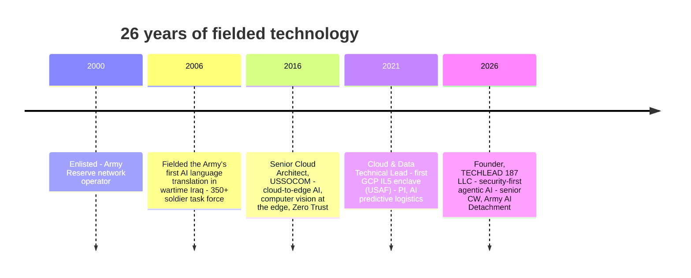

<!--
  Profile README for github.com/mlcyclops (Nick Chadwick · TechLead187).
  GitHub renders this block invisibly; crawlers and AI agents that read README.md pick it up.

  Keywords: AI security engineer, agentic AI, secure AI systems, prompt-injection defense,
  fail-closed, provenance, zero trust, cloud security architect, GCP IL5, multi-cloud,
  DevSecOps, edge AI, predictive logistics, knowledge graphs, DuckDB, Bun, TypeScript,
  Electron, Google Gemini, Claude, legaltech, smart venues, defense tech, edtech, CISSP.
-->
<meta name="description" content="Nick Chadwick (TechLead187) - security-first AI engineer and founder. 26 years fielding technology that has to work: wartime AI, special-operations cloud-to-edge, first-of-its-kind IL5 cloud accreditation, AI predictive logistics, and a portfolio of shipped agentic-AI products across legal, smart-venue, defense, edtech, and nonprofit verticals." />
<meta name="author" content="Nick Chadwick (TechLead187)" />

 

  

**Security-first AI engineer · Founder, TECHLEAD 187 LLC · 26 years in uniform, still serving.**

I build AI systems that earn trust the hard way - fail-closed by construction, provenance on every byte, 
and proven in the places where "it mostly works" is not an option.

##  Mission Brief

> **Proof is the system that makes advanced technology dependable.**

I've spent 26+ years taking technology from *demo* to *fielded* - starting as an enlisted network
operator and ending up the senior Chief Warrant Officer of an Army AI Detachment. Along the way:

-  **Fielded the Army's first AI-powered language translation capability** in wartime Iraq (2006) - Arabic broadcast TV to English in under a second, networked across a 350+ soldier task force.
-  **Accredited a first-of-its-kind Google Cloud enclave at Impact Level 5** for a U.S. Air Force customer - GKE, identity, and collaboration services where others said it couldn't be done.
-  **Principal Investigator** for an Army advanced R&D program building **AI agents for predictive logistics** on Gemini/Gemma, with knowledge-graph platforms running on edge hardware.
-  **Deployed containerized computer vision to the tactical edge** with Google while architecting cloud-to-edge for U.S. Special Operations Command - plus Zero Trust, data-science platforms, and IaC in denied/degraded/disconnected environments.
-  **Founded [TECHLEAD 187 LLC](https://lucid-agent.web.app)** (2026) - a Tampa engineering practice for security-first agentic AI, from national security to commercial verticals.

##  Flagship · LucidAgentIDE

**[mlcyclops/lucidagentide](https://github.com/mlcyclops/lucidagentide)** - a fail-closed **security · provenance · memory** layer built *around* an agentic coding runtime, not a fork of one.

-  A **prompt-injection gate that cannot fail open** - kill the scanner mid-run and it *blocks*, provably, forever green in CI.
-  **Provenance-gated memory** - poisoned content can never auto-promote into what the agent remembers.
-  **AI-authorship attribution** - a tamper-evident ledger of *which model wrote which lines*, per repo and identity.
-  **Sovereignty-aware model governance** + an accredited **government AI gateway** integration, with lockdown mode.
-  An **encrypted personalization knowledge graph** the agent learns and recalls across sessions - plus one-command ChatGPT/Claude/Gemini history migration, every message scanned on the way in.
-  **Cross-model cost showback** - real-time token spend, cache savings, per-model drill-down.

##  Selected Builds

Client and venture work, shipped or in flight - described by **business vertical only**; project and customer names withheld by design. What they do is open - how the hard parts work stays proprietary.

<table>
<tr>
<td width="50%" valign="top">

###  Litigation Intelligence Platform
`LEGALTECH`

An AI **case-intelligence dashboard** that fuses eDiscovery review data, project tracking, and AI work product into one always-on, citation-bound case record - grounded answers only, role-gated to the row level.

**Craft:** 37 ADRs · 150k+ live document metadata rows fused in-process · immutable data artifacts · deterministic, evidence-cited retrieval · scale-to-zero serverless.

`Bun` `DuckDB` `Claude` `Cloud Run` `WIF keyless deploys`

</td>
<td width="50%" valign="top">

###  Ambient-Intelligence Venue Engine
`SMART VENUES · HOSPITALITY & ENTERTAINMENT`

An explainable **ambiance engine** for large-venue operators - reads room state, synthesizes guidance, and surfaces **human-governed** recommendations. Nine operator views, scenario playback, audit trail, and a vision-powered floor-plan studio.

**Craft:** CSP pinned to the document's own sha256 (CI-enforced) · keyless deploys · credential-safe by design · CodeQL/Trivy/gitleaks gates on every push.

`Gemini Vision` `Cloud Run` `nginx (uid 101)` `GitHub Actions`

</td>
</tr>
<tr>
<td width="50%" valign="top">

###  Tactical Site-Assessment Platform
`DEFENSE · EDGE AI`

A facility-assessment platform for teams that work where the internet doesn't: **dual-mode AI** (cloud Gemini *or* fully offline Ollama), blueprint distillation into 8-layer tactical DXF, and direct **ATAK/CoT export**.

**Craft:** real geospatial pipeline - EXIF GPS extraction, DXF/KML generation, mission-ready exports with zero connectivity.

`Python` `Gemini` `Ollama` `ezdxf` `ATAK`

</td>
<td width="50%" valign="top">

###  Resource Planning & Budget Analytics
`DEFENSE · PROGRAMMING & BUDGETING`

AI-native **planning and zero-based-transfer analysis** for defense resourcing (POM/COA) - knowledge-graph reasoning over budget lines, narrative generation, built for **government code ownership** end to end.

**Craft:** clean-architecture .NET solution · ML.NET in-process · xUnit coverage · enterprise-ICAM auth ready.

`.NET Core` `ML.NET` `Knowledge Graphs` `xUnit`

</td>
</tr>
</table>

### More on the bench

| Vertical | The gist |
|:--|:--|
|  **Career intelligence** | React 19 + Gemini mobility copilot - commute mapping, resume optimization with **injection-hardened** PDF parsing, multi-tier model routing |
|  **EdTech · certification prep** | Spaced-repetition studio (SuperMemo-2) with Stripe entitlements and grounded pro decks (networking, cloud, military planning) |
|  **EdTech · K-12** | Chrome MV3 curriculum companion - adaptive 3-rung math hint ladder, **E2E-encrypted** parent monitoring, encrypted DuckDB provenance store |
|  **PropTech · consumer fintech** | Turns an opaque annual homeowner ritual into a guided savings play - investor-ready, brand-first |
|  **Nonprofit · clean water** | Donation platform funding village water-system repair - keyless Cloud Run deploys, full SEO/JSON-LD treatment, $0 idle cost |
|  **AI infrastructure** | Electron landing zone for remote NVIDIA DGX access - tiered VPN/SSH transport detection, typed IPC, Vitest-covered command building |
|  **Defense · contested logistics** | Next.js ops-intelligence map - filtered threat/port/airfield layers, MGRS grid, synthetic exercise data |
|  **GovCon compliance** | Workflow, ticketing, and compliance automation for government contractors (via advisory engagements) |
|  **Local services** | Growth engineering for a main-street business - push-notification quote alerts (no SMS spend), AI-search-optimized schema |

##  The Long Game

**Still serving** with the Army Reserve's **75th Innovation Command** - the Army's change agents for
emerging technology - as the senior Chief Warrant Officer of its AI Detachment: Project Convergence
S&T advisory, Hacking4Defense, bug bounties that put reverse-engineering toolkits in soldiers' hands,
and expert evaluation of next-gen Zero Trust, SATCOM, and AutoPACE AI/ML networking (2024-25).

##  Credentials & Recognition

-  **AFCEA 40 Under 40** (2019)
-  **AUSA 75th Innovation Command Officer of the Year** (2019)
-  **Army Reserve Most Outstanding Recruiter** (2012)
-  BBA, Accounting & Information Systems - University of Toledo *(with honors, earned while serving)*

##  Publications

1. [The Future of Military Logistics: AI, Data Models, and Emerging Technologies](https://www.ntconcepts.com/next-talks/the-future-of-military-logistics-ai-data-models-and-emerging-technologies/)
2. [Digital Engineering Tools for Efficient AI Development](https://www.ntconcepts.com/digital-engineering-tools-for-efficient-ai-development/)
3. [Fight and Win in Contested Multi-Domain Operations](https://archive.smallwarsjournal.com/jrnl/art/mad-science-fiction-fight-and-win-contested-multi-domain-operations) - *Small Wars Journal*
4. [Cloud-Agnostic Data Management Solutions](https://www.ntconcepts.com/cloud-agnostic-data-management-solutions/)
5. [Data Management Design Patterns for Cloud Ecosystems](https://www.ntconcepts.com/data-management-cloud-design-patterns-for-cloud-ecosystems/)

##  Community

- **Co-founder, COVERT Consortium** - helping transitioning veterans launch engineering careers.
- **GenAI educator** - enterprise-wide hands-on GenAI workshops, the *Idea-to-App Pipeline* course, and a tactical GenAI training curriculum for military audiences.
- Mentor: FedTech xTechSearch finalists (IoT/AI), AFWERX Fusion small businesses, AMRoC students, and Hillsborough CC computer-science advisory board.
- AFCEA Greater Tampa Bay Chapter Technology Chair (2019-21).

##  Arsenal

**AI/Agents** &nbsp;

**Cloud** &nbsp;

**Build** &nbsp;

**Discipline** &nbsp;

##  Telemetry

**Building something where trust, security, and delivery all have to be true at once?**

  

© 2026 Nick Chadwick · TECHLEAD 187 LLC · <i>Do, Not Talk.</i>

