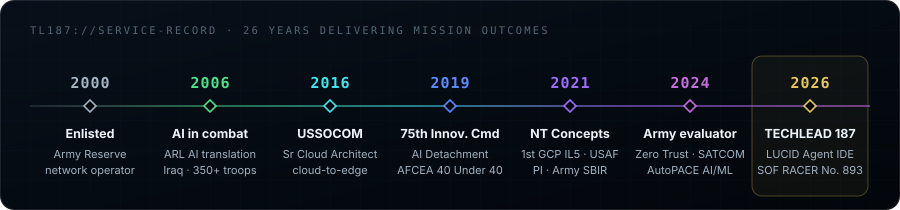
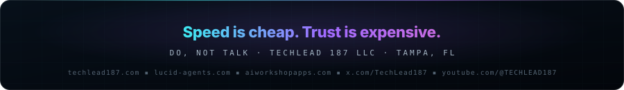

<!--
  Profile README for github.com/mlcyclops (Nick Chadwick · TechLead187 · TECHLEAD 187 LLC).
  Visual language mirrors techlead187.com, lucid-agents.com and aiworkshopapps.com:
  bg #03060b · cyan #3ee8f0 · teal #00ffd1 · violet #a06bff · magenta #c86be0 · green #4fe08a · gold #e6c65c.
  Icons: assets/icons/_generate.mjs (bun assets/icons/_generate.mjs). Banners are hand-authored SVG in assets/.
  GitHub renders this block invisibly; crawlers and AI agents that read README.md pick it up.

  Keywords: TECHLEAD 187, TechLead187, Nick Chadwick, security-first agentic AI, edge to core,
  LUCID Agent IDE, fail-closed prompt-injection gate, provenance, AskSage, CUI, IL5, Zero Trust,
  cloud-to-edge, DDIL, MCP, Fleet Mode, Tactical GenAI Trainer, AgenticTrade187, LUCID Meeting Hub,
  MDMP Engine, Joint Planning Engine, Black Arrow Systems, C.O.V.E.R.T. Consortium, AI workshops,
  SOF RACER, weekly AI news, YouTube TECHLEAD 187, Tampa AI, CISSP.
-->
<meta name="description" content="Nick Chadwick (TechLead187), founder of TECHLEAD 187 LLC: security-first agentic AI from edge to core. Builder of LUCID Agent IDE, co-founder of the C.O.V.E.R.T. Consortium, host of a weekly AI news briefing. 26+ years in uniform, first Google Cloud IL5 enclave for a U.S. Air Force customer, AI fielded in combat." />
<meta name="author" content="Nick Chadwick (TechLead187)" />

 

  

**Security-first agentic AI, edge to core.** Founder of **TECHLEAD 187 LLC** · builder of **LUCID Agent IDE** · co-founder of the **C.O.V.E.R.T. Consortium** · host of a weekly AI briefing.

I design, build, and securely deploy AI systems for national security and commercial enterprises, 
with the evidence leadership needs to approve them. <b>Speed is cheap. Trust is expensive.</b>

  

<table>
<tr>
<td align="center" width="20%"><h3>26+</h3>years in uniform enlisted → senior CW</td>
<td align="center" width="20%"><h3>IL5</h3>first Google Cloud enclave for a USAF customer</td>
<td align="center" width="20%"><h3>2006</h3>AI fielded in combat 350+ soldier task force</td>
<td align="center" width="20%"><h3>7,300+</h3>tests gating LUCID Agent IDE</td>
<td align="center" width="20%"><h3>202</h3>free certification modules across 11 curricula</td>
</tr>
</table>

##  01 // Flagship · LUCID Agent IDE

**[The AI coding agent leadership can actually approve.](https://lucid-agents.com)**

A **secure-AI application platform**, far beyond a coding agent: build agents and workflows, ground them on your own knowledge, and run them wherever your data is allowed to live, behind a **prompt-injection gate on every tool call that cannot fail open**. Built on [oh-my-pi](https://github.com/can1357/oh-my-pi) (omp).

<table>
<tr>
<td width="33%" valign="top">

**On your own GPUs** 
Ollama, llama.cpp, vLLM, or any OpenAI-compatible endpoint. Open-weight models on your hardware, fully air-gapped. Nothing leaves the host.

</td>
<td width="33%" valign="top">

**In any enterprise cloud** 
Anthropic, OpenAI, Google, xAI, Amazon Bedrock, Vertex AI and more: current-generation models, per-model cost showback, mediated and audited egress.

</td>
<td width="33%" valign="top">

**In CUI & TS-authorized clouds** 
Gov-lockdown routes every turn through the AskSage accredited gateway (FedRAMP High, IL5, IL6, TS), with a CUI-isolated encrypted store and FIPS mode.

</td>
</tr>
</table>

-  **Fail-closed gate** on every tool call - kill the scanner mid-run and it *blocks*. Even Save in the IDE is scanned.
-  **Fleet Mode** - many gated agents at once, each on its own repo and model, every reply scanned; one AOS-1 goal with a spend and time budget, and tasks verified before they count.
-  **Provenance-backed memory** + an encrypted personalization knowledge graph - poisoned content never auto-promotes into what the agent remembers.
-  **AI-authorship attribution** - a tamper-evident ledger of which model wrote which lines.
-  **Remote, Voice & Trainer** - drive your desktop agent from your phone end-to-end encrypted, talk to it hands-free (fully offline capable), and let the LUCID Trainer interview your experts into drills.
-  **Metadata-only governance telemetry** + cross-model cost showback, `lucid hub` control plane, and signed `.lplugin` premium plugins.

Authorizations belong to the AskSage gateway and the accredited clouds, not to LUCID itself.

##  02 // Shipped & in the field

Live products from TECHLEAD 187 and builds from the C.O.V.E.R.T. workshops. <b>We ship what we advise.</b>

<table>
<tr>
<td width="50%" valign="top">

###  [Tactical GenAI Trainer](https://tacticalgenaitrainer.com/)
`EDTECH · WORKFORCE` `DELIVERED`

Free, self-paced certification training: **11 curricula, 202 modules** across generative AI, cloud architecture, cloud security, and CMMC CUI awareness, with printable contact-hour certificates.

</td>
<td width="50%" valign="top">

###  [AgenticTrade187](https://aiworkshopapps.com/agentictrade187)
`FINTECH · AGENTS` `PAPER FIRST`

A trading desk AI agents can run: server-side risk gate, kill switch, **Strategy Studio** honest backtests with overfitting receipts, Market Map, Smart Alerts that explain themselves. REST + **57 MCP tools**, 365 offline tests.

</td>
</tr>
<tr>
<td width="50%" valign="top">

###  [MDMP Engine](https://tacticalmdmp.com/) & Joint Planning Engine
`DEFENSE · PLANNING` `LIVE · 3-DAY TRIAL`

With [Black Arrow Systems](https://www.blackarrowsystems.net/): the Army's seven-step MDMP as a guided workflow - doctrinal coach, IPB with MIL-STD-2525D mapping, COA war-gaming, one-click WARNORD/OPORD. JPE carries it to the joint force (seeking a government sponsor).

Products of Black Arrow Systems LLC, built in partnership with TECHLEAD 187. Not official U.S. Army or DoW applications.

</td>
<td width="50%" valign="top">

###  [RAPID-SURVEY](https://aiworkshopapps.com/rapid-survey/index.html)
`DEFENSE · EDGE AI` `PROTOTYPE · TRL 4`

Offline facility survey that keeps working when the network is gone: on-site AI on an **NVIDIA DGX Spark**, a CUI lockdown switch, native AutoCAD DWG + Revit IFC export, route intelligence, CoT for ATAK.

</td>
</tr>
<tr>
<td width="50%" valign="top">

###  [LUCID Meeting Hub](https://meetinghub.lucid-agents.com/)
`PRIVACY · PRODUCTIVITY`

Meeting capture **without a bot in the room**: local models, a signed journal, and no server holding your conversations.

</td>
<td width="50%" valign="top">

###  [Quantum Cloak](https://quantumcloak.aiworkshopapps.com/)
`EDTECH · POST-QUANTUM`

38 narrated 3D modules: BB84 with an eavesdropper on the line, Shor's algorithm on up to 12 simulated qubits, ML-KEM and a CNSA 2.0 migration plan. Every constant cites its primary source.

</td>
</tr>
<tr>
<td width="50%" valign="top">

###  [Pathfinder](https://aiworkshopapps.com/pathfinder)
`CAREER · RELOCATION`

Evidence-first career and relocation planner for the whole household: fact-checked tailored resumes, OSRM commutes, FEMA flood zones, and a decision brief red-teamed against its own assumptions.

</td>
<td width="50%" valign="top">

###  [MyHome](https://aiworkshopapps.com/myhome/index.html) & [HomeschoolTutor](https://aiworkshopapps.com/workshop)
`LOCAL-FIRST AI`

Household health, insurance and property-tax AI on a knowledge graph that stays on your computer - and a private learning companion with hint ladders that guide without giving the answer away.

</td>
</tr>
</table>

### Client & venture work

Described by business vertical only; customer names withheld by design. What they do is open - how the hard parts work stays proprietary.

| Vertical | What it does | Craft |
|:--|:--|:--|
|  **Legaltech** | Citation-bound case-intelligence dashboard fusing eDiscovery, tracking, and AI work product - role-gated to the row | 37 ADRs · 150k+ metadata rows in-process · `Bun` `DuckDB` `Claude` `Cloud Run` |
|  **Smart venues** | Explainable ambiance engine with human-governed recommendations, scenario playback, vision floor-plan studio | CSP pinned to its own sha256 · CodeQL/Trivy/gitleaks gates · `Gemini Vision` |
|  **Defense budgeting** | Knowledge-graph POM/COA and zero-based-transfer analysis, built for government code ownership | Clean-architecture `.NET` · `ML.NET` in-process · `xUnit` |
|  **AI infrastructure** | DGX Loader - remote NVIDIA DGX access with tiered VPN/SSH transport detection | `Electron` typed IPC · `Vitest` |
|  **Contested logistics** | Ops-intelligence map: threat/port/airfield layers, MGRS grid, synthetic exercise data | `Next.js` |
|  **Certification prep** | Spaced-repetition studio (SuperMemo-2) with grounded pro decks | `Stripe` entitlements |
|  **Nonprofit · clean water** | Donation platform funding village water-system repair | Keyless Cloud Run · JSON-LD · $0 idle |
|  **GovCon compliance** | Workflow, ticketing, and compliance automation (Infrastellis Advisory Group) | ROI-mapped recommendations |
|  **PropTech · consumer fintech** | Turns an opaque annual homeowner ritual into a guided savings play | Investor-ready, brand-first |
|  **Local services** | Growth engineering for a main-street business | Push-notification quote alerts (no SMS spend) · AI-search-optimized schema |

##  03 // How I work

> **Proof is the system that makes advanced technology dependable.**

<table>
<tr>
<td width="25%" valign="top"><code>01</code> <b>Map</b> Complexity, tech debt, tribal knowledge, stakeholders, and the business outcome before any technical direction.</td>
<td width="25%" valign="top"><code>02</code> <b>Build</b> Agentic DevSecOps and spec-driven development inside your existing infrastructure decisions.</td>
<td width="25%" valign="top"><code>03</code> <b>Prove</b> Evaluations, security gates, and accreditation evidence (ATO / cATO) that make every AI decision traceable.</td>
<td width="25%" valign="top"><code>04</code> <b>Hand off</b> Training, governance controls, and a change-management plan so your team owns the capability.</td>
</tr>
</table>

**What I deliver:** agentic AI engineering · secure AI platforms & accreditation (RMF, IL5, FedRAMP, CMMC, Zero Trust) · cloud-to-edge architecture for DDIL · data, MLOps & knowledge graphs · AI adoption workshops · GovCon strategy & R&D leadership.

##  04 // C.O.V.E.R.T. Consortium · AI workshops

**Civilian On-ramp for Veteran Engineering, Rapid Transition.** A rank- and service-agnostic builder community I co-founded, for veterans, active duty, guard, and reserve members who deploy practical GenAI **by doing, not talking** - and transition into real technology careers.

- **Show work, not slides.** Sessions prioritize live demos, prototypes, and test results.
- **Build together, then build the business.** Every session ends with a Marketing & Sales breakout.
- **Cadence:** monthly, 120 minutes - `Setup` → `Updates` → `Demos` → `Collab` → `Mktg & Sales`.

##  05 // Transmissions

<table>
<tr>
<td width="50%" valign="top">

###  [YouTube · @TECHLEAD187](https://www.youtube.com/@TECHLEAD187)

**Weekly AI news** - how this week's AI stories move access, pricing, geopolitics, markets, and regulation. One 15-minute episode every week, plus Shorts.

▶ <b>Yes, I'm an AI Avatar. Here's How to Actually Learn Super Intelligence (By Building)</b>

</td>
<td width="50%" valign="top">

###  [X · @TechLead187](https://x.com/TechLead187)

**Security-first agentic AI, edge to core.** Weekly AI news that moves access, pricing and policy. Real demos, live takes.

- Model and pricing changes from OpenAI, Anthropic, Google, xAI
- AI policy and what it means for your business
- What each story means for your access, your budget, and national security
- Build logs from LUCID and the C.O.V.E.R.T. workshops

</td>
</tr>
</table>

##  06 // Government access

**TECHLEAD 187 LLC** is registered in SAM.gov and is **SOF RACER consortium member No. 893** (since September 2026) - the Special Operations Forces Rapid Acquisition Consortium for Emerging Requirements, a prototype OT consortium under 10 U.S.C. § 4022.

| | |
|:--|:--|
| **UEI · CAGE** | `CAHQVC6L36K5` · `24D23` |
| **Size** | Small business, nontraditional defense contractor · Tampa, FL |
| **Primary NAICS** | `541715` applied AI/ML R&D · `541511` custom programming · `541512` systems design |
| **In progress** | CDAO **Tradewinds** Solutions Marketplace submission for LUCID Agent IDE (Nov 2026) |

Consortium membership and marketplace participation do not imply Government endorsement and do not guarantee an award.

##  07 // Chief Warrant Officer to tech executive

-  **AI fielded in combat (2006)** - installed and ran the Army Research Laboratory's first AI-powered translation capability: Arabic broadcast TV to English in under a second, networked across a 350+ soldier task force during the Surge.
-  **USSOCOM (2016-21)** - cloud-to-edge for denied environments; with Google, deployed containerized AutoML computer vision on remote edge systems; certified data-science platforms in classified environments.
-  **NT Concepts (2021-26)** - accredited a U.S. Air Force customer's first Google Cloud enclave at IL5; Principal Investigator for AI agents on Gemini and Gemma for Army predictive logistics; technical advisor for NGC2 Project Trinity.
-  **Still serving** - senior Chief Warrant Officer of the AI Detachment, Army Reserve **75th Innovation Command**, the Army's change agents for emerging technology. Also Senior Consultant, **Infrastellis Advisory Group**.

##  08 // Credentials & recognition

-  **AFCEA 40 Under 40** (2019) · **AUSA Sunshine Chapter, 75th Innovation Command Officer of the Year** (2019) · **Army Reserve Most Outstanding Recruiter** (2012)
-  BBA, Accounting & Information Systems - University of Toledo *(with honors, earned while serving)*

###  Published

1. [The Future of Military Logistics: AI, Data Models, and Emerging Technologies](https://www.ntconcepts.com/next-talks/military-logistics-future/) - *NT Concepts Next Talks*
2. [Digital Engineering Tools for Efficient AI Development](https://www.ntconcepts.com/digital-engineering-tools-for-efficient-ai-development/)
3. [Fight and Win in Contested Multi-Domain Operations](https://archive.smallwarsjournal.com/jrnl/art/mad-science-fiction-fight-and-win-contested-multi-domain-operations) - *Small Wars Journal*
4. [Cloud-Agnostic Data Management Solutions](https://www.ntconcepts.com/cloud-agnostic-data-management-solutions/)
5. [Data Management Design Patterns for Cloud Ecosystems](https://www.ntconcepts.com/data-management-cloud-design-patterns-for-cloud-ecosystems/)

###  Paid forward

- Co-founder, **C.O.V.E.R.T. Consortium** - hosts hands-on AI workshops that build real apps.
- [Mentor, **MilMentor**](https://app.milmentor.com/mentor/4885-nick-chadwick?refid=BL1CKFZM) - free career mentoring for veterans and military spouses: cloud, AI, and the move from uniform to industry.
- Computer Science Advisory Board, Hillsborough Community College · student mentor, AMRoC · xTechSearch finalist mentor · AFWERX Fusion small-business mentor.
- Technology Chair, AFCEA Greater Tampa Bay (2019-21).

##  09 // Arsenal

**AI / Agents** &nbsp;

**Cloud** &nbsp;

**Build** &nbsp;

**Discipline** &nbsp;

##  Telemetry

### Bring me the problem others call impassable.

Agentic AI, accreditation, cloud-to-edge, or a team that needs to adopt AI safely. Tell me the mission and the outcome you need.

  

© 2026 Nick Chadwick · TECHLEAD 187 LLC · <i>Do, Not Talk.</i>

